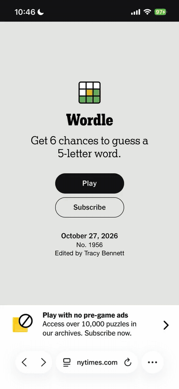

# iPhoneMCP

Computer use for a real iPhone, driven from a Mac. Claude (or any agent, script
or app) can see the phone's screen, tap, type, open apps and Settings pages,
answer prompts, and report where the storage went. Nothing extra on the phone
beyond Apple's own UI-testing runner.

## Demo



Claude on a real iPhone 14, driving Safari through this repo: today's Wordle
(BINGO in 5 guesses), the free Spelling Bee at spellbee.org (15 words, all
accepted) and NYT Connections (all four groups, no mistakes). It was recorded
from the phone's own live stream and is shown at 2x speed. The only cut is a
minute of idle time on Wordle's results screen.
[Full-quality MP4](docs/demo-2x.mp4). The steps are in
[recipes/DEMO.md](recipes/DEMO.md).

## Four ways in

| | For | How |
|---|---|---|
| **MCP server** | Claude Code and other agents | `phone_*` tools; `skills/iphone/SKILL.md` teaches the fast way to use them |
| **`iphone` CLI** | your terminal and scripts | `iphone goto storage`, `iphone do '[...]'`, `iphone storage --deep` |
| **iPhone Live** | watching and other apps | `iphone live` opens http://127.0.0.1:8780: the phone's screen live, Connect/Stop, every agent action, storage reports; the same URL serves an HTTP API |
| **Run journal** | future sessions | each session's actions, storage reports over time and notes, in a private GitHub repo |

## How the setup works

```
Claude (MCP) / iphone CLI / iPhone Live
        │
        ▼
iphone_mcp  ── Phone: every action, the safety guard, the activity log
   ├─ WebDriverAgent engine ── HTTP :8100 over Wi-Fi ──▶ runner app on the phone (unlocked)
   │      accessibility tree · taps and drags · apps by bundle id · alerts · URLs
   │      MJPEG :9100 ──▶ screenshots · "has the screen settled?" · iPhone Live · recordings
   ├─ scripts/wda_start.sh ── xcodebuild over USB ──▶ keeps the runner's test session alive
   ├─ iPhone Mirroring engine (mirrorctl, Swift) ──▶ the mirrored window, when the phone is locked
   └─ pymobiledevice3 ── lockdown and AFC over USB ──▶ storage, apps, battery (no screen needed)
```

What happens from start to finish:

1. **The runner on the phone.** [WebDriverAgent](https://github.com/appium/WebDriverAgent)
   (pinned at v16.15.3 in `vendor/`) is an XCUITest bundle. Xcode builds it, signs it
   with a free Apple ID (Personal Team), and installs it on the phone over USB. It is
   not an app you open. It runs only while an `xcodebuild test-without-building`
   process on the Mac holds a test session. Free signing lasts 7 days, and the start
   script re-signs when under 2 days remain.
2. **Connecting.** `iphone connect`, `phone_connect` or the Connect button in iPhone
   Live runs `scripts/wda_start.sh` in the background (log in `build/wda.log`).
   - iOS then turns on automation mode, which asks for **Face ID or the passcode on the
     phone**. You approve it; if nobody does, it gives up after 60 s.
   - The phone then shows "Automation Running". The runner serves HTTP on port 8100
     and an MJPEG video stream on port 9100, and its address is saved to `build/wda.url`.
3. **Seeing.** A read is one `GET /source`: the front app's accessibility tree as JSON.
   - `wda.py` turns it into labelled items with tap points, such as
     `(195,398) [button] Play`. It drops what is off screen or under another layer and
     flags alerts. No screenshot or OCR is involved.
   - A background thread keeps the newest frame of the MJPEG stream, so screenshots
     cost nothing, and "wait until the screen settles" means comparing frames.
4. **Acting.** Taps, drags, typing, launching apps by bundle id, opening URLs and
   answering alerts are HTTP calls to the runner. It injects them through XCTest as
   real touches, so it works in any app, including Settings and Safari. Every action
   goes through `phone.Phone`, which applies the safety guard and records what
   happened for iPhone Live and the journal.
5. **The cable.** The test session runs over the USB link to Xcode's device services.
   - On networks that block device discovery (Bonjour), like UT's campus Wi-Fi, the
     runner can only start with the cable in, and unplugging ends it.
   - The HTTP and video traffic go over Wi-Fi either way.
   - On a network that allows discovery, Xcode can also reach a paired phone without
     the cable; that has not been tested here.
6. **Stopping.** `iphone stop` or `phone_disconnect` calls `GET /wda/shutdown`, which
   ends the test session and clears "Automation Running". Killing xcodebuild instead
   leaves the banner up. The start script also stops the runner after 120 s with no
   calls (`IPHONE_WDA_IDLE`), and the session's actions go to the run journal.
7. **When the phone is locked**, WebDriverAgent cannot act, so the same tools fall back
   to iPhone Mirroring on the Mac: ScreenCaptureKit capture, Vision OCR, and mouse and
   key events, through the `mirrorctl` helper.
8. **Without the screen**, pymobiledevice3 talks to the phone's lockdown and file
   services over USB for storage reports, the app list, battery and model.
9. **Recording.** `iphone record start` / `stop` saves the MJPEG stream to
   `build/recordings/*.mp4` with ffmpeg. The demo above is one of these.

### The two engines side by side

The tools are the same either way; `phone_status` says which one is driving.

| | WebDriverAgent (preferred) | iPhone Mirroring (fallback) |
|---|---|---|
| Phone state | unlocked, can be in your hand | locked, near the Mac |
| Reads the screen from | the accessibility tree (exact names, icon-only buttons, switch states) | OCR of the mirrored window |
| Opens apps | by bundle id (instant), Spotlight for unknown names | Spotlight |
| System alerts | WebDriverAgent's alert API | layout guess + tap |
| Needs | Xcode, free Apple ID signing, Developer Mode, Face ID at each start, the cable on campus Wi-Fi | nothing on the phone |

## Setup (one time)

**WebDriverAgent** (the main engine):

1. On the phone: Settings > Privacy & Security > Developer Mode, then restart.
2. Build and sign the runner:

   ```bash
   git clone --depth 1 --branch v16.15.3 https://github.com/appium/WebDriverAgent.git vendor/WebDriverAgent
   scripts/wda_start.sh --build   # signs with your Personal Team as com.shaunakkapur.WebDriverAgentRunner
   ```

3. Plug the phone in, tap *Trust* on it, and run `iphone connect`. The first launch
   may ask you to trust the developer on the phone (Settings > General > VPN & Device
   Management). Approve the Face ID prompt when it appears.

`IPHONE_ENGINE=mirror|wda` forces an engine; `IPHONE_WDA_URL` points at a runner
started some other way.

**iPhone Mirroring** (the fallback for a locked phone):

1. Open iPhone Mirroring on the Mac and follow the prompt on the phone. In iPhone
   Mirroring > Settings choose *Authenticate Automatically* so it doesn't stop for
   Touch ID each session.
2. Give the app that runs the server (Claude Code shows as `claude`) *Accessibility*
   (to click and type) and *Screen & System Audio Recording* (to see the phone) in
   System Settings > Privacy & Security.

**Register with Claude Code:**

```bash
claude mcp add --scope user iphone /Users/shaunkapoor/iPhoneMCP/run.sh
```

`run.sh` uses `.venv` (`uv venv && uv pip install -r requirements.txt`). The
Swift helper rebuilds itself from `bridge/mirrorctl.swift` when the source is
newer than `bin/mirrorctl` (needs only the Command Line Tools).

## Why this design

| Option | Verdict |
|---|---|
| **WebDriverAgent / XCUITest** (chosen) | A real accessibility tree with exact labels, the phone usable in your hand, every app including Settings. Costs: full Xcode, a free signing profile that lasts 7 days, Developer Mode, Face ID at each start, and the cable on campus Wi-Fi. |
| iPhone Mirroring + macOS automation (fallback) | Built into macOS 15+/iOS 18+, nothing on the phone, works while the phone is locked. Control is by pixels and OCR, and the phone has to stay locked and near the Mac. |
| Lockdown only (pymobiledevice3) | Device facts, app sizes, file access. No touch input; screenshots need Developer Mode + a root tunnel on iOS 17+. Used here as the read-only device layer. |
| Bluetooth HID (ESP32 mouse + AssistiveTouch) | Blind without a video feed; hardware. |
| Shortcuts / jailbreak | No general UI control / not acceptable. |

## Using it

Plug the phone in, unlock it, and run `iphone connect` (approve Face ID on the
phone); `iphone live` shows the screen. If the phone is locked, the tools use
iPhone Mirroring instead: lock it, leave it near the Mac, and call `phone_connect`.

Coordinates are **phone points** (iPhone 14: 390 x 844, origin top-left).
Screenshots are scaled so one image pixel is one point, and every text item
comes with its tap point, so most steps don't need an image at all.

| Tool | What it does |
|---|---|
| `phone_status`, `phone_connect`, `phone_disconnect` | readiness and why not; start an engine; stop WebDriverAgent (clears "Automation Running") |
| `phone_watch` | open iPhone Live on the Mac |
| `phone_do` | many steps in one call: `[{"goto": "storage"}, {"tap": "General"}, {"wait_for": "..."}]`; stops at the first failure or refusal |
| `phone_goto` | jump to a Settings page by name (storage, battery, wifi, about, software update, ...) in one call |
| `phone_open_app`, `phone_open_url` | apps by name or bundle id; web pages and app deep links |
| `phone_tap`, `phone_long_press` | by visible `text` or `x,y` |
| `phone_swipe`, `phone_scroll` | finger drags; scroll moves exactly the amount asked |
| `phone_type`, `phone_key` | typing into the focused field |
| `phone_go` | `home`, `app_switcher`, `spotlight`, `back` |
| `phone_alert` | read or answer an alert / permission prompt / confirmation sheet; `button="dismiss"` is the safe way out |
| `phone_dismiss` | clear whatever is in the way in one call: ads (waits out "Skip in 5 s"), popups, X's (labelled or drawn), cookie banners (always Reject) |
| `phone_keys` | type on a keyboard drawn by an app or page (Wordle, keypads): `"crane"` + `then="enter"`, one read then back-to-back taps |
| `phone_record` | record the live screen to an MP4 (`start` / `stop`) |
| `phone_read_screen`, `phone_screenshot`, `phone_zoom`, `phone_find`, `phone_wait` | seeing and waiting; `phone_screenshot(marks=true)` numbers every element and `phone_tap(text="#12")` taps one |
| `phone_storage_report` | free space, every app (app vs. data), and with `deep=true` a camera roll scan; ends with ways to get space back. No screen needed |
| `phone_journal`, `phone_note` | read earlier sessions' notes and runs; save a note for later |
| `device_info`, `device_apps` | model, iOS, battery; installed apps |

### HTTP API (iPhone Live, 127.0.0.1:8780)

```
GET  /api/status   /api/screen   /api/activity?since=<unix time>   /api/storage?deep=1   /stream (MJPEG)
POST /api/connect  /api/disconnect  /api/do {"steps": [...]}  /api/goto {"place": "storage"}
```

POST endpoints need the header `X-iPhone-Agent: 1` (so web pages on other
origins cannot drive the phone). Refusals come back as 409 with the reason.

```bash
curl -s -X POST localhost:8780/api/do -H 'X-iPhone-Agent: 1' -H 'Content-Type: application/json' \
  -d '{"steps": [{"goto": "battery"}, {"wait_for": "Battery Health"}]}'
```

### Run journal

`phone_disconnect` (and the idle auto-stop) uploads the session's actions to
`runs/` in the private repo `shaunak1206/iphone-agent-journal`; every storage
report goes to `reports/storage/` and a row in `history.csv`; `phone_note`
appends to `NOTES.md`. Typed text is never logged. `IPHONE_JOURNAL=0` turns it
off, `IPHONE_JOURNAL_REPO=owner/name` points it elsewhere.

### Speed

Measured on an iPhone 14 (iOS 26.4) over Wi-Fi, WebDriverAgent engine:

| | |
|---|---|
| tap | ~0.6 s |
| read the screen | ~1 s: the accessibility tree 0.3-0.5 s plus a SpringBoard alert check ~0.55 s (WebDriverAgent's own visibility check would add ~5 s, so geometry is used instead) |
| a word on a page keyboard (Wordle) | ~0.6 s per key: one request per tap, because batching taps in one touch request does not register on a real phone |
| screenshot | free: a background thread keeps the newest frame of the phone's MJPEG stream |
| after an action | wait until the stream's frames stop changing (0.12-1.2 s) instead of a fixed pause |
| storage report | ~20 s apps + disk, ~45 s more for the camera roll (6 parallel AFC connections) |

Where the time really goes is round trips between the agent and the phone, so
the tools are built to need few: `phone_do` batches, `phone_keys`/`taps` resolve
many taps from one read, `phone_dismiss` clears layered popups in one call,
`phone_goto` and `phone_storage_report` are whole tasks. Ideas taken from
[Maestro](https://github.com/mobile-dev-inc/maestro) (tap, then compare frames
instead of waiting for idle), [AppAgent](https://github.com/TencentQQGYLab/AppAgent)
(set-of-marks screenshots), [mobile-mcp](https://github.com/mobile-next/mobile-mcp)
(batched commands), and WebDriverAgent's own settings (`shouldWaitForQuiescence`,
`waitForIdleTimeout`, `animationCoolOffTimeout`, MJPEG frame rate and quality).
Turning on Settings > Accessibility > Motion > Reduce Motion on the phone shortens
every transition further.

### Recipes

`recipes/games.py` shows a task done the fast way: Wordle, a free Spelling Bee
(spellbee.org) and NYT Connections in Safari (`--chrome` for Chrome), one call per move, with word lists
from [wordfreq](https://github.com/rspeer/wordfreq) (`pip install -e '.[games]'`).

### Why not a hosted (Vercel) viewer

The phone sits on a private network (campus Wi-Fi) and streams over plain HTTP.
A page served from the cloud cannot reach it, and browsers block an HTTPS page
from loading an HTTP stream from a private address. iPhone Live runs on the Mac
next to the phone instead; exposing it remotely would need an authenticated
tunnel, which is deliberately not set up.

### Safety rails

- Taps on controls labelled delete / erase / reset / remove / offload / buy /
  pay / send / post / sign out / confirm / discard are refused unless
  `confirm=True`, which the agent may pass only after the user says yes in chat
  (or the request asked for exactly that).
- Prompts are read from their layout (centered question, known button labels
  stacked or side by side) and flagged as `PROMPT on screen` in every readout.
  Answering one is judged with its question: *Allow* / *Trust* / *Accept*
  (granting access, accepting terms) and *OK* / *Continue* to a destructive
  question ("Delete 'Instagram'?") also need `confirm=True`. *Cancel*,
  *Don't Allow*, *Not Now* never do.
- Passcode and password screens are flagged; the agent never types them.
- The device layer is read-only. Cleanup happens through the phone's own UI,
  where it is visible (Recently Deleted keeps photos 30 days; *Offload App*
  keeps app data).
- After every action, focus and the mouse cursor go back to where you had them
  (`IPHONE_RESTORE_FOCUS=0` to disable).

### Other phone sizes

Set `IPHONE_WIDTH_PT` / `IPHONE_HEIGHT_PT` in the server env (e.g. 430 x 932
for Pro Max models).

## Tests

```bash
.venv/bin/python tests/test_smoke.py   # offline: every tool via FastMCP against tests/fake_wda.py and fake_mirrorctl.py
.venv/bin/python tests/live_check.py   # live, read-only walk through Settings on the real phone
./run.sh --check                       # readiness report
```
